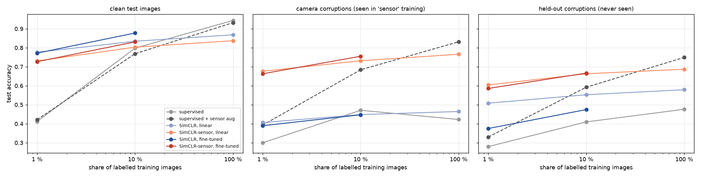
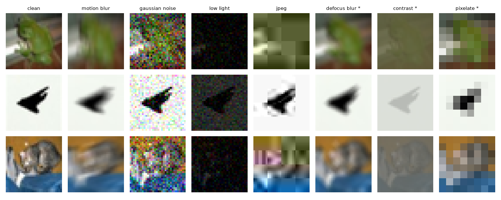
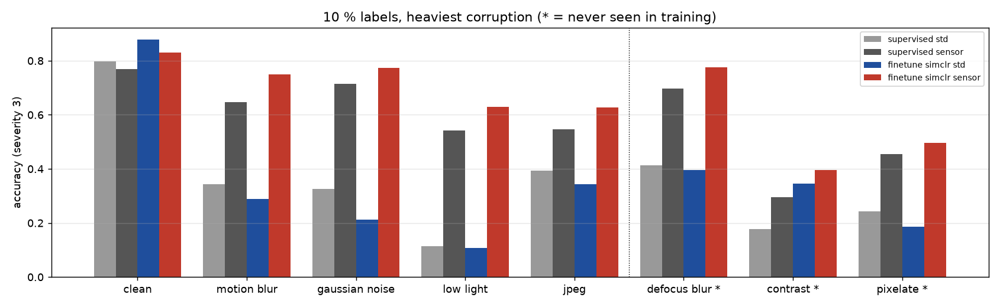

# Does self-supervised pre-training make a robot's vision robust, or just label-efficient?

[](https://github.com/HessamKaveh/simclr-contrastive-learning/actions/workflows/ci.yml)   [](LICENSE) [](https://doi.org/10.5281/zenodo.24465874)

### SimCLR vs supervised training on CIFAR-10, with few labels and a degraded camera

Self-supervised pre-training such as SimCLR is usually sold on **label efficiency**: learn from unlabelled images,
then reach good accuracy with few labels. A robot camera adds a second requirement, **robustness**. Its images are
blurred by motion, noisy, dark and JPEG-compressed, and the corruptions it meets in deployment are not always the
ones anyone anticipated.

This project measures both in one controlled setup (one architecture, one dataset, one evaluation). It also tests a
simple idea: put the camera's corruptions into the SimCLR augmentations (**"SimCLR-sensor"**), so that the
representation learns to ignore them before any label is seen.



---

## Key findings

CIFAR-10 test set (10,000 images), clean and under 7 corruptions × 3 severities. The 4 "camera" corruptions are used
in sensor-aware training. The 3 held-out ones never are. 1 % label results average 3 random label subsets. CIs from
a bootstrap over test images are ±0.8 points or less.

| # | Question | Finding |
|---|----------|---------|
| 1 | **How much does SimCLR save in labels?** | About 10×. A linear classifier on the frozen SimCLR encoder with **1 % of the labels** (500 images) reaches **77.6 %**, vs **41.1 %** for the same ResNet-18 trained from scratch on those labels, and 79.8 % from scratch with 10 % of the labels. With all labels, supervised training wins (94.4 vs 86.8 %). |
| 2 | **Is a standard SimCLR encoder robust to a bad camera?** | No. On the 4 camera corruptions it is about as fragile as a supervised model: **46 %** (linear, 100 % labels) vs 42 %. In low light both drop to chance (11 %). The one exception is contrast (78 % vs 32 %), because SimCLR's colour-jitter augmentation already contains contrast changes. Robustness comes from the augmentations, not from self-supervision as such. |
| 3 | **Does adding camera corruptions to SimCLR help?** | A lot, and with no labels involved. With 1 % labels, SimCLR-sensor reaches **67.6 %** on camera corruptions (vs 40.6 % for SimCLR) and 60.4 % on held-out ones (vs 50.8 %), at a cost of 4.5 points on clean images. It matches supervised + sensor augmentation trained with **10 × more labels** (68.4 % / 59.2 %). |
| 4 | **Does the robustness transfer to corruptions never seen?** | Partly, and unevenly. Defocus blur benefits strongly, because it resembles motion blur (46.7 → 68.3 %). Pixelation does not (15 → 33 %), and contrast **gets worse** (68.9 → 54.0 %; the cause was not isolated here). "Held-out robustness" is mostly robustness to *similar* corruptions. |
| 5 | **Does fine-tuning keep the invariances learned in pre-training?** | No. Fine-tuning standard SimCLR on 10 % of the labels raises clean accuracy (83.4 → **87.8 %**), but erases its contrast robustness (75.3 → 34.6 %) and lowers held-out accuracy (55.3 → 47.4 %). For SimCLR-sensor, fine-tuning keeps the robustness to camera corruptions, because the labelled training also used them. |
| 6 | **With all labels available, is self-supervision still worth it?** | Not on CIFAR-10. Supervised + sensor augmentation with 100 % of the labels is the most accurate and most robust model overall (93.2 % clean, 83.1 % camera, 74.9 % held-out). The case for SimCLR-sensor is the low-label regime, ≤ 10 % labels, where it is the best option on every axis except clean accuracy. |

**Bottom line:** self-supervision buys label efficiency, while robustness has to be designed into the augmentations.
For a robot with few labelled images, putting its own camera's failure modes into the self-supervised augmentations is
a near-free way to get both.

---

## 1. Setup

**Corruptions** (`src/corrupt.py`), each at 3 severities:


*Severity 3. \* = never used in any training.*

| group | corruption | severity 1 / 2 / 3 |
|---|---|---|
| camera (seen by "sensor" models) | motion blur | kernel 3 / 5 / 7 px, random angle |
| | Gaussian noise | σ = 0.04 / 0.08 / 0.14 |
| | low light | gain 0.5 / 0.3 / 0.18, gamma 1.5 / 2 / 2.5, plus read noise |
| | JPEG | quality 20 / 10 / 5 |
| held out | defocus blur | disk radius 1 / 1.5 / 2 px |
| | contrast | ×0.4 / 0.25 / 0.15 |
| | pixelate | 16 / 12 / 8 px, then upsampled |

The test images are corrupted once, with a per-image seed, so every model sees exactly the same corrupted images.
"Sensor" training applies one random camera corruption at random strength to 50 % of training images (SimCLR: to
each view independently).

**Models.** All are a ResNet-18 adapted to 32 × 32 inputs (3 × 3 stem, no max-pool).

| name | pre-training (no labels, 50,000 images) | training with labels |
|---|---|---|
| supervised | – | from scratch, SGD, 300 / 100 / 60 epochs at 1 / 10 / 100 % labels |
| supervised + sensor aug | – | the same, plus sensor augmentation |
| SimCLR, linear | SimCLR, 100 epochs, batch 256, τ = 0.2 | frozen encoder + logistic regression |
| SimCLR, fine-tuned | same | whole network, lr 0.05 |
| SimCLR-sensor, linear / fine-tuned | SimCLR + camera corruptions in the augmentations | the same, with sensor augmentation when fine-tuned |

Label subsets are class-balanced: 1 % = 50 images per class. The last epoch is evaluated, so there is no model
selection on the test set. SimCLR at 100 epochs gives 86.8 % linear accuracy, in line with published ResNet-18 /
CIFAR-10 results at this budget.

## 2. Results

Accuracy (%) on clean test images and averaged over the 4 camera and 3 held-out corruptions at all 3 severities:

| model | labels | clean | camera | held-out |
|---|---|---|---|---|
| supervised | 1 % | 41.1 | 30.0 | 28.0 |
| supervised + sensor aug | 1 % | 42.1 | 39.3 | 33.0 |
| SimCLR, linear | 1 % | **77.6** | 40.6 | 50.8 |
| SimCLR, fine-tuned | 1 % | 77.2 | 39.0 | 37.5 |
| SimCLR-sensor, linear | 1 % | 73.1 | **67.6** | **60.4** |
| SimCLR-sensor, fine-tuned | 1 % | 72.7 | 66.3 | 58.6 |
| supervised | 10 % | 79.8 | 47.1 | 41.0 |
| supervised + sensor aug | 10 % | 76.9 | 68.4 | 59.2 |
| SimCLR, linear | 10 % | 83.4 | 44.8 | 55.3 |
| SimCLR, fine-tuned | 10 % | **87.8** | 44.7 | 47.4 |
| SimCLR-sensor, linear | 10 % | 80.3 | 73.2 | 66.3 |
| SimCLR-sensor, fine-tuned | 10 % | 83.1 | **75.5** | **66.6** |
| supervised | 100 % | **94.4** | 42.2 | 47.6 |
| supervised + sensor aug | 100 % | 93.2 | **83.1** | **74.9** |
| SimCLR, linear | 100 % | 86.8 | 46.4 | 57.9 |
| SimCLR-sensor, linear | 100 % | 83.7 | 76.6 | 68.7 |

### 2.1 Per corruption (10 % labels, severity 3)



| model (10 % labels) | clean | motion blur | noise | low light | JPEG | defocus* | contrast* | pixelate* |
|---|---|---|---|---|---|---|---|---|
| supervised | 79.8 | 34.4 | 32.6 | 11.5 | 39.3 | 41.3 | 17.7 | 24.3 |
| supervised + sensor aug | 76.9 | 64.7 | 71.6 | 54.2 | 54.6 | 69.8 | 29.6 | 45.5 |
| SimCLR, linear | 83.4 | 32.6 | 23.2 | 11.4 | 29.3 | 50.8 | **75.3** | 15.3 |
| SimCLR, fine-tuned | **87.8** | 29.0 | 21.2 | 10.7 | 34.3 | 39.7 | 34.6 | 18.6 |
| SimCLR-sensor, linear | 80.3 | 71.7 | 74.9 | 60.2 | 61.1 | 74.8 | 61.2 | 34.9 |
| SimCLR-sensor, fine-tuned | 83.1 | **74.9** | **77.3** | **63.0** | **62.8** | **77.7** | 39.7 | **49.7** |

\* never seen in training. Severity 3 is deliberately harsh: low light at severity 3 leaves an almost black image.

## Limitations

* CIFAR-10 at 32 × 32 px. Real camera images are larger and the corruptions are spatially varying, so the absolute
  numbers will not transfer. The comparisons between training recipes should.
* Synthetic corruptions. The "camera" set was designed by the same person who designed the sensor augmentation, so
  results on it are optimistic by construction. The held-out set is the honest test, and it shows the gains are
  uneven.
* One pre-training run per SimCLR variant and one seed at 10 / 100 % labels. Bootstrap CIs cover test-set
  sampling, not training randomness.
* SimCLR was trained for 100 epochs (published numbers use 500 to 1,000). Longer pre-training would raise the
  linear-probe numbers but is unlikely to change the robustness picture, which is driven by the augmentations.

## Reproduce

```bash
pip install -r requirements.txt
# CIFAR-10 as npz (X uint8 NHWC, y) in $CIFAR_DIR, see src/data.py
python src/train.py simclr --sensor 0 --epochs 100                 # ~50 min on an RTX 500 Ada (4 GB)
python src/train.py simclr --sensor 1 --epochs 100
for s in 0 1; do
  for f in 0.01 0.1 1.0; do python src/train.py supervised --frac $f --sensor $s; done
  python src/train.py finetune --frac 0.1  --init simclr_$([ $s = 1 ] && echo sensor || echo std) --sensor $s
  python src/train.py finetune --frac 0.01 --init simclr_$([ $s = 1 ] && echo sensor || echo std) --sensor $s
done   # plus --seed 1 / 2 for the 1 % runs
python src/evaluate.py                                             # linear probes, all test conditions, figures
```

```
src/corrupt.py   camera and held-out corruptions, sensor augmentation
src/data.py      CIFAR-10, class-balanced label subsets, SimCLR pairs, corrupted test sets
src/model.py     CIFAR ResNet-18, SimCLR projection head, NT-Xent loss
src/train.py     SimCLR pre-training, supervised training, fine-tuning
src/evaluate.py  linear probes, accuracy with bootstrap CIs, calibration, figures
```

The earlier version of this repository (plain SimCLR + linear probe) is still in the git history, and its weights are
in the `v1.0` release.

## References

* Chen, Kornblith, Norouzi, Hinton. *A Simple Framework for Contrastive Learning of Visual Representations* (SimCLR). ICML 2020.
* Hendrycks, Mazeika, Kadavath, Song. *Using Self-Supervised Learning Can Improve Model Robustness and Uncertainty.* NeurIPS 2019.
* Hendrycks, Dietterich. *Benchmarking Neural Network Robustness to Common Corruptions and Perturbations.* ICLR 2019.
* Geirhos et al. *Generalisation in Humans and Deep Neural Networks.* NeurIPS 2018.
* Krizhevsky. *Learning Multiple Layers of Features from Tiny Images* (CIFAR-10). 2009.

## Citation

If you use this code, please cite it (metadata in [`CITATION.cff`](CITATION.cff)):

```bibtex
@software{kaveh2026_simclr_contrastive_learning,
  author  = {Kaveh, Hessam},
  title   = {Does self-supervised pre-training make a robot's vision robust, or just label-efficient?},
  year    = {2026},
  version = {1.1.0},
  doi     = {10.5281/zenodo.24465874},
  url     = {https://github.com/HessamKaveh/simclr-contrastive-learning},
  license = {MIT}
}
```

---

**Author:** Hessam Kaveh, Research Fellow, Italian Institute of Technology (IIT)

License: MIT
