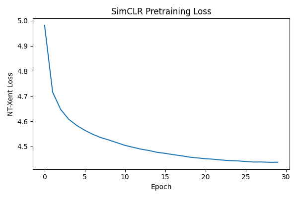
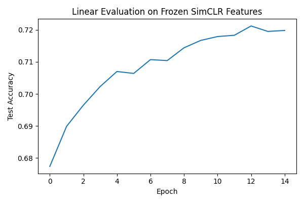

# Self-Supervised Contrastive Learning (SimCLR) from Scratch

A from-scratch implementation of SimCLR: learning image representations
without labels via contrastive learning, evaluated with linear probing.

## Pipeline
1. **Pretraining**: for each image, generate two augmented views (random crop,
   color jitter, grayscale, flip); train a ResNet18 encoder + projection head
   to pull matching views together and push apart other images in the batch
   (NT-Xent / InfoNCE loss)
2. **Linear Evaluation**: freeze the pretrained encoder, train only a linear
   classifier on top using labeled data, to measure representation quality

## Key Components
- Custom NT-Xent (contrastive) loss implemented from scratch
- ResNet18 backbone adapted for small (32x32) images
- Strong augmentation pipeline (crop, color jitter, grayscale, flip)

## Installation
```bash
pip install -r requirements.txt
```

## Usage
```bash
python src/pretrain.py       # Self-supervised pretraining
python src/linear_eval.py    # Evaluate representation quality
```

## Results

| Metric | Value |
|---|---|
| Linear-probe accuracy, CIFAR-10 test set (frozen encoder) | **72.1 %** |
| Pretraining epochs / linear-probe epochs | 30 / 15 |

<p align="center"></p>

<p align="center"></p>

## Author
Hessam Kaveh — Research Fellow, Italian Institute of Technology

## License

Released under the [MIT License](LICENSE).
